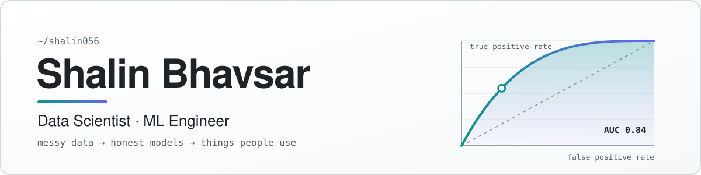
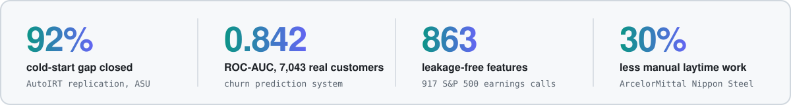

<picture>
  <source media="(prefers-color-scheme: dark)" srcset="assets/banner-dark.svg">
  
</picture>

**M.S. Data Science, Analytics & Engineering, Arizona State University (4.0 GPA)** · Redmond, WA

[LinkedIn](https://linkedin.com/in/shalinbhavsar) &nbsp;·&nbsp; [Email](mailto:shalin03bhavsar@gmail.com) &nbsp;·&nbsp; [Selected work](#selected-work) &nbsp;·&nbsp; [Toolbox](#toolbox)

<picture>
  <source media="(prefers-color-scheme: dark)" srcset="assets/stats-dark.svg">
  
</picture>

## I build models I can defend

I like the part of machine learning that comes after the first good number: checking whether it's real, explaining why it works, and putting it somewhere people can use it.

When my YouTube virality model scored 0.771 AUC, I went looking for the catch. I found a channel-level leak, fixed it, and published the honest **0.622** instead. That habit of validating before celebrating is how I work.

## Right now

- **Research with Dr. Yi Zheng (ASU):** replicating *AutoIRT* (Sharpnack et al., 2024) on a real 3,290/585-item DET item bank. I closed the cold-start calibration gap by 92% (Pearson gap 0.344 → 0.027).
- **Dataset Trust Report:** license, lineage and health scores for Hugging Face datasets, an end-to-end big data project using free tools only, with Spark at the core.
- **Looking for** new-grad roles in **data science, ML engineering and software engineering**.

## Selected work

<table>
<tr>
<td width="50%" valign="top">

### [Earnings Call & Risk Intelligence Engine](https://github.com/Shalin056/Earnings-Intelligence-Engine)
ASU capstone. Fuses FinBERT embeddings, Loughran–McDonald sentiment and financial ratios to predict 3-day abnormal returns.

**0.633 held-out ROC-AUC** · DeLong p = 0.012 vs. sentiment-only · 863 features from 917 S&P 500 calls · LangGraph orchestration, Streamlit app

`FinBERT` `XGBoost` `SHAP` `LangGraph`

</td>
<td width="50%" valign="top">

### [Customer Churn Prediction System](https://github.com/Shalin056/churn-prediction-system)
Leakage-safe churn model on the real IBM Telco data, with a cost-sensitive ROI framework instead of a vanity metric.

**0.842 ROC-AUC** · 2.86× top-decile lift · $13,111 incremental net value over random targeting · Streamlit app for real-time and batch scoring

`scikit-learn` `Random Forest` `SHAP` `Streamlit`

</td>
</tr>
<tr>
<td width="50%" valign="top">

### [YouTube Virality & Engagement](https://github.com/Shalin056/youtube-engagement-optimizer)
Predicts virality from pre-publish signals only. Includes hypothesis tests (Mann–Whitney, Kruskal–Wallis, bootstrap A/B) to separate real drivers from noise.

**AUC 0.771 → 0.622 after fixing my own leak** · 40,500 videos · FastAPI + Tableau dashboard

`XGBoost` `SciPy` `FastAPI` `Tableau`

</td>
<td width="50%" valign="top">

### [AutoIRT Replication](https://github.com/Shalin056/Autoirt)
A Monte Carlo EM pipeline for calibrating adaptive-test items from content features alone.

**Difficulty recovery −0.23 → 0.88** with non-linear feature transforms · cold-start Pearson +24% using real-content NLP item generators · replicated across 5 seeds

`Python` `LightGBM` `XGBoost` `NLTK`

</td>
</tr>
<tr>
<td width="50%" valign="top">

### [Hybrid Swarm Text Classification](https://github.com/Shalin056/HybridSwarm_TextClassification)
LSTM text classifier on AG News (120K samples) tuned by PSO, GWO and a hybrid of both, with convergence analysis of exploration vs. exploitation.

**89.3% test accuracy**

`TensorFlow` `Keras` `PSO` `GWO`

</td>
<td width="50%" valign="top">

### [LAYTIME](https://github.com/Shalin056/LAYTIME)
Production laytime calculator built during my time at ArcelorMittal Nippon Steel India, plus structured QA that raised reliability by 25%.

**30% less manual calculation time**

`React` `Django REST` `PostgreSQL`

</td>
</tr>
</table>

## Toolbox

| | |
| :-- | :-- |
| **Modeling** | scikit-learn · XGBoost · LightGBM · PyTorch · TensorFlow/Keras · SHAP · LSTM · reinforcement learning |
| **NLP & LLMs** | FinBERT · LangChain · LangGraph · spaCy · NLTK · Gensim · topic modeling (LDA) |
| **Statistics** | A/B testing · hypothesis testing · regression · time-series CV · cohort and funnel analysis |
| **Engineering** | Python · SQL · R · Java · JavaScript · Django · React · FastAPI · Docker · GitHub Actions |
| **Data & cloud** | Pandas · NumPy · BigQuery · PostgreSQL · MongoDB · AWS · Oracle Cloud · Tableau · Streamlit |

## Credentials

Oracle Cloud Infrastructure **Data Science Professional** · **Generative AI Professional** · **AI Foundations Associate** (2025) &nbsp;·&nbsp; AWS Academy **Cloud Foundations**

 

*If you're hiring for data science or ML engineering, [I'd love to talk](mailto:shalin03bhavsar@gmail.com).*

